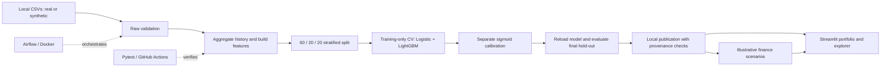
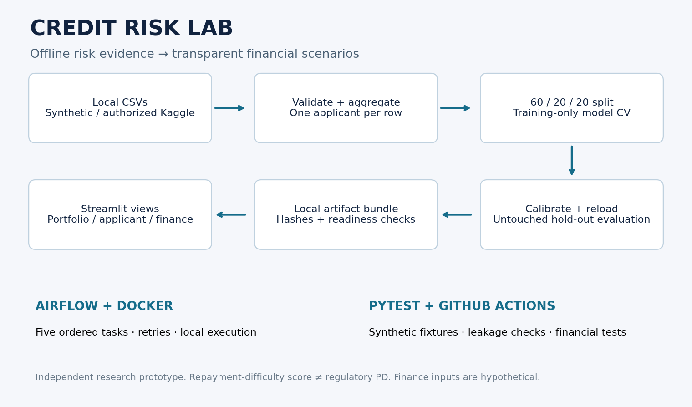
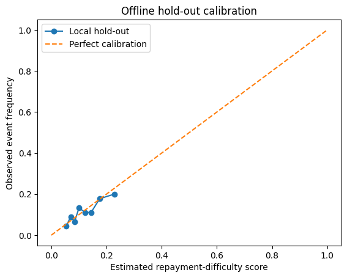
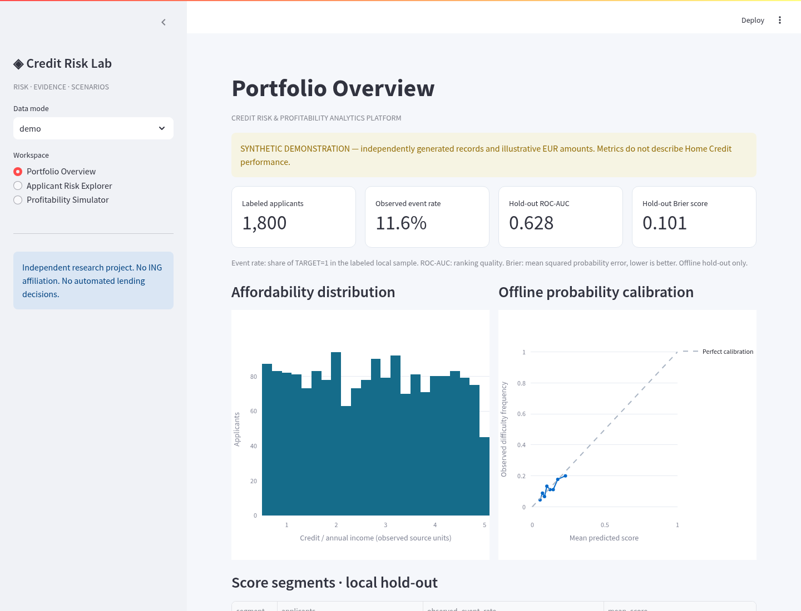
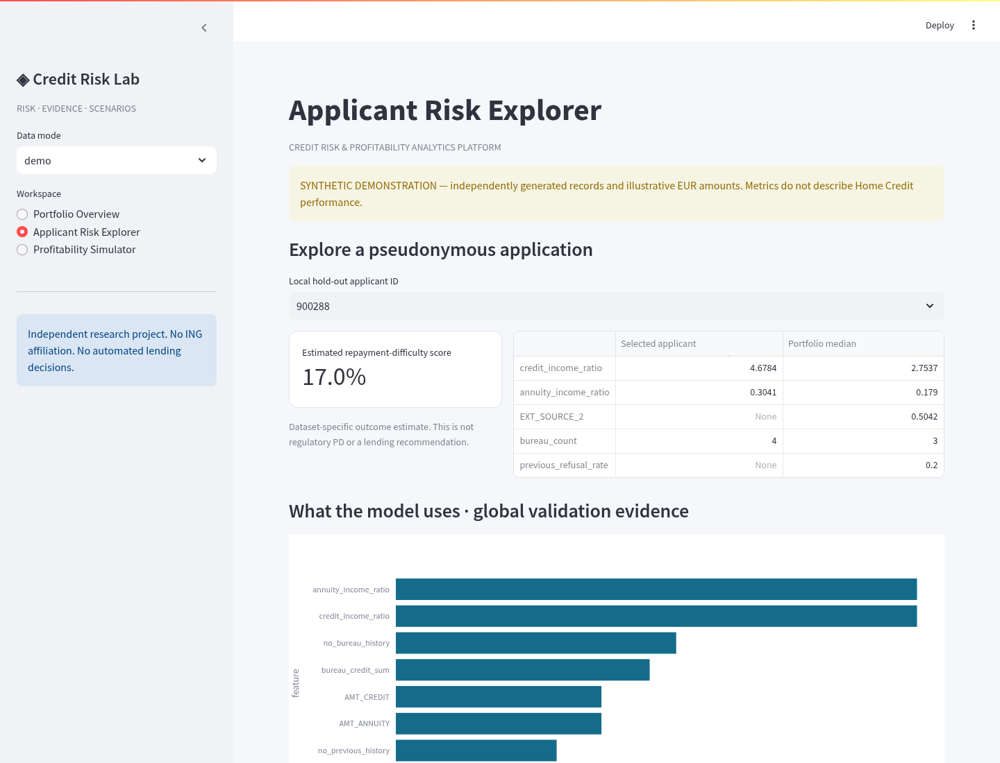
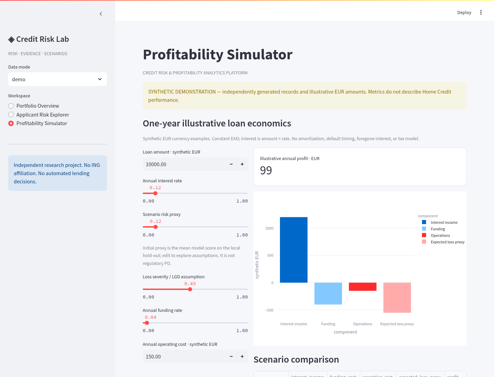

# Credit Risk & Profitability Analytics Platform

[](https://github.com/yipeng-913/credit-risk-profitability-platform/actions/workflows/ci.yml)

An **unofficial independent project**, inspired by a mock ML engineering assessment. No affiliation with or endorsement by ING or Home Credit. A reproducible research prototype combining repayment-difficulty modeling, offline evaluation, and explicitly hypothetical loan economics.

**Current evidence uses independently generated synthetic data, not Kaggle records.** The real-data adapter is implemented but has not been validated on the full Home Credit dataset. The demo is not a production credit-decision tool, and its scores are not validated regulatory PDs.

## What you can run

- Applicant-level feature pipeline integrating `bureau` and `previous_application`, strict key/domain assertions, 20 allowlisted model inputs including 15 engineered features, Parquet and DuckDB segment analysis.
- Logistic Regression and LightGBM with training-only three-fold cross-validation, sigmoid calibration, a separate final hold-out, persisted/reloaded model, and permutation importance.
- Three Streamlit views: portfolio, applicant explorer, and profitability simulator with adjustable financial assumptions.
- Five-stage Apache Airflow DAG, Docker Compose, synthetic-data CI and 18 automated test cases.
- Six EDA figures, ROC/PR and calibration figures, a confusion matrix, financial scenarios and a six-part demo narrative.

## Quick start · Python 3.12

Verified locally with Python 3.12.14. Direct Python dependencies are versioned in `requirements.txt`; Airflow is pinned in `requirements-airflow.txt`. Local development, CI and Docker use the same dependency files. Transitive dependencies are resolved by pip, rather than a fully hashed lockfile.

```bash
git clone https://github.com/yipeng-913/credit-risk-profitability-platform.git
cd credit-risk-profitability-platform
python3.12 -m venv .venv
source .venv/bin/activate
pip install -r requirements-airflow.txt
python -m src.pipeline run --mode demo
streamlit run dashboard/app.py
```

Open http://localhost:8501. A fixed seed creates 1,800 entirely synthetic applicants and two historical tables. Artifacts are local and ignored by Git. `READY.json` is written only after successful publication. Load only trusted local joblib files: pickle-based artifacts can execute code.

```bash
ruff check .
pytest -q
# Individual stages are also available:
python -m src.pipeline evaluate --mode demo
```

## Real Home Credit data

1. Independently visit the [official Kaggle competition](https://www.kaggle.com/competitions/home-credit-default-risk/data), create an account and accept the competition rules.
2. Download and extract `application_train.csv`, `bureau.csv`, `previous_application.csv`, and `HomeCredit_columns_description.csv` into `data/raw/`. The official dictionary explains source units and fields; the synthetic placeholder is not a substitute.
3. Run `python -m src.pipeline run --mode real`, then select **real** in the dashboard. Read the new reports under `artifacts/real/`.

No Kaggle credentials, competition data, derived applicant extracts or trained models are committed. Demo and real artifacts have separate directories. `application_test.csv` is unlabeled and is never used for local metrics. The base adapter reads selected columns into memory; chunked aggregation is a future improvement for constrained machines. Do not copy the synthetic files into `data/raw/`.

## Architecture





`src/data/` validates and describes data; `src/features/` builds applicant rows; `src/models/` trains and evaluates; `src/finance/` contains pure financial functions. `src/pipeline.py` provides stage entry points shared by the CLI and DAG. Additional directories: `dashboard/`, `dags/`, `sql/`, `tests/`, `notebooks/`, `reports/` and `docs/`.

## Experiment design and results

Applicants are split 60% training, 20% calibration and 20% final hold-out using seed 42 and stratification. Within the training partition, each fold fits its own imputer, scaler and encoder. Hyperparameters are fixed; model choice uses mean training-CV average precision. The winning model is refit on training only; sigmoid calibration fits only on the calibration partition. Evaluation genuinely reloads the saved pipeline in a separate stage and uses only the untouched hold-out. IDs, split membership and artifact hashes are persisted locally.

The historical tables are aggregated before one-to-one left joins. Negative historical date offsets exclude future/same-day records, but they **do not prove snapshot availability** of balances and statuses. The source lacks sufficient as-of metadata for deployment-grade temporal validation. Random splits measure a local sample, not future performance.

**Synthetic demonstration only · 360 held-out applicants**

| Metric | Value |
|---|---:|
| ROC-AUC | 0.6284 |
| PR-AUC (average precision) | 0.2051 |
| Brier score | 0.1008 |
| Positive-class prevalence / AP reference | 0.1167 |

Training-CV average precision: Logistic Regression 0.1935; LightGBM 0.1775. **Selected model: logistic**. A more complex model is retained as a comparison, not assumed to be better.

At the prespecified demonstration threshold 0.20: TN=290, FP=28, FN=35, TP=7. False positives could deny suitable customers; false negatives could increase losses. This threshold illustrates the trade-off and is not a lending policy. No cost-optimal or fairness-approved threshold is claimed. Brier should be interpreted against event prevalence, and calibration should be reviewed by score range.



See [results and recommendations](reports/results.md), [EDA](reports/eda_findings.md), and the generated [synthetic evidence](reports/demo/). The notebooks call the tested modules and read local artifacts; execute from the repository or `notebooks/` directory after running the pipeline. Notebook execution additionally requires an IPython/Jupyter environment.

## Illustrative finance

Synthetic currency examples use EUR. Source competition amounts are retained in their source units and are not relabeled EUR. A one-year constant-exposure example computes:

`profit = EAD × interest rate − EAD × funding rate − operating cost − risk proxy × LGD × EAD`

PD is probability of a defined default over a defined horizon; LGD is loss given default; EAD is exposure at default. Here the model predicts dataset-specific **repayment difficulty**, so `risk proxy × LGD × EAD` is an illustrative loss scenario, not a validated regulatory ECL estimate. The simulator initializes its editable risk assumption from the mean hold-out model score. Higher risk multiplies the assumption by 1.5; funding stress adds 2 percentage points. Rates are capped at 100%.

An arithmetic reference using EUR 10,000, 12% interest, 4% funding, EUR 150 operating cost, 10% risk proxy and 45% LGD yields EUR 200 illustrative profit. This reference is separate from the model-score-seeded exported scenarios. See [financial assumptions](reports/financial_assumptions.md).

## Dashboard demo

1. **Portfolio Overview:** labeled sample counts and event rate, observed affordability distribution, score bands on the local hold-out and offline calibration.
2. **Applicant Risk Explorer:** choose a pseudonymous hold-out ID; reload and score it; compare its inputs with portfolio medians. Global calibration-set permutation importance is explicitly distinguished from an applicant-level explanation.
3. **Profitability Simulator:** vary six assumptions and compare the base, higher-risk and funding-stress scenarios.





Missing artifacts display the exact pipeline command; invalid financial values are rejected by the engine and UI controls. Definitions and limitations remain visible. Screenshots contain only independently generated synthetic records.

## Airflow and Docker

```bash
export AIRFLOW_HOME="$PWD/.airflow"
export AIRFLOW__CORE__LOAD_EXAMPLES=false
airflow db migrate
airflow dags test credit_risk_pipeline 2025-01-03 --subdir dags/credit_risk_pipeline.py
```

This executes all five tasks using Airflow's local DAG test mode. A captured successful run is in [the workflow report](docs/verification.md); this is distinct from a production scheduler deployment.

For the local Airflow UI and scheduler:

```bash
cp .env.example .env
# Edit .env and choose a local password. Do not commit it.
mkdir -p data artifacts
# Linux: allow the container GID 0 to write the bind mounts.
sudo chgrp -R 0 data artifacts
chmod -R g+rwX data artifacts
docker compose build
docker compose up -d
# After init finishes, trigger the DAG:
docker compose exec airflow-scheduler airflow dags unpause credit_risk_pipeline
docker compose exec airflow-scheduler airflow dags trigger credit_risk_pipeline
```

Airflow UI: http://localhost:8080 (`admin`, password from `.env`). Dashboard: http://localhost:8501. The dashboard shows a useful missing-artifacts message until the DAG publishes. Bind mounts must be writable by the container user (UID 50000, GID 0); adjust directory ownership/group permissions for your host rather than using world-writable permissions. `airflow-init` is a first-run step: if an existing admin makes reinitialization fail, run `docker compose run --rm airflow-init airflow db migrate` and start services with `--no-deps` after migration. For real mode, place the files in `data/raw/`, set `CREDIT_MODE=real`, recreate services and trigger the DAG.

The DAG is `validate_raw_data → build_features → train_model → evaluate_model → publish_local_artifacts`. One retry follows a 15-second delay; failed upstream tasks prevent downstream publication under the default all-success trigger. Stages overwrite deterministic mode-specific paths and validate provenance; publication is invalidated when rebuilding. Run one writer at a time: `max_active_runs=1` protects scheduled DAG runs, not simultaneous manual CLI processes. SQLite/SequentialExecutor is a local demo choice, not a production deployment. Logs live in the named volume. `docker compose down` preserves local state; do not delete volumes unless you intend to discard it.

## Engineering evidence and limits

CI installs the same requirements, lints code, executes 18 tests, runs the synthetic pipeline and executes the actual Airflow DAG. Tests cover key integrity, target domain, historical aggregation, future-row filtering, target independence, financial arithmetic and boundaries, split disjointness, artifact round-trip and stale-input rejection. See [verification details](docs/verification.md) for checks actually performed and container status.

Implemented and demonstrated: selected-column base adapter, both history joins, both models, calibration/evaluation, SQL, finance, three dashboard views, DAG and synthetic CI. **Not implemented or not validated:** full real-data training, timestamped bank-grade snapshots, fairness validation, SHAP/local attribution, drift automation, MLflow, production serving, regulatory ECL, independent validation or realized-profit backtesting. The CI badge links to the actual workflow rather than a manually asserted status.

## Ethics, limitations and next steps

No recommendation to auto-approve/reject loans. Before any pilot: align outcome and time horizon; obtain timestamped authorized bank data; validate calibration out of time and by segment; assess fairness/proxy discrimination (age and income type can be sensitive); involve independent model validation, legal/privacy review and human oversight; collect actual pricing, funding, recovery, cost and profit labels. Missingness and historical refusal patterns can encode past policy and bias.

Third-party references: [Kaggle Home Credit](https://www.kaggle.com/competitions/home-credit-default-risk), [scikit-learn calibration](https://scikit-learn.org/stable/modules/calibration.html), [LightGBM](https://lightgbm.readthedocs.io/), [Airflow](https://airflow.apache.org/docs/apache-airflow/2.10.5/), [Streamlit](https://docs.streamlit.io/). Code written for this independent project with AI assistance. No external solution or competition dataset is redistributed.

中文项目表述见 [简历描述](docs/resume_zh.md)。请将其列为独立项目，不要列为 ING 工作经历。
